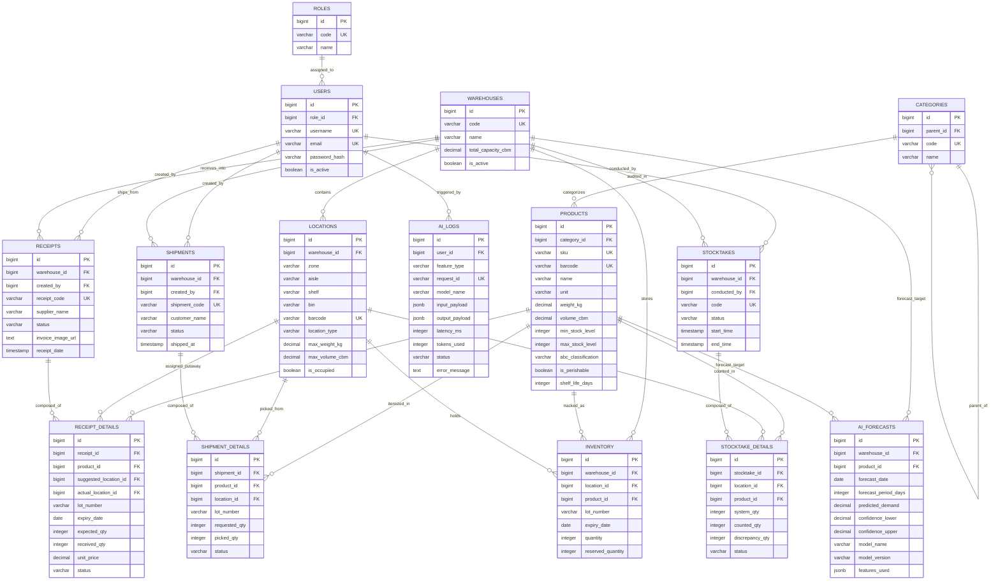

# THIẾT KẾ CƠ SỞ DỮ LIỆU SQL (DATABASE DESIGN & SCHEMA)
## Dự án: Hệ Thống Quản Lý Kho Áp Dụng AI (AI-WMS)

---

## 1. SƠ ĐỒ QUAN HỆ THỰC THỂ (ERD - ENTITY RELATIONSHIP DIAGRAM)



---

## 2. CHI TIẾT CÁC BẢNG SQL (TABLE SCHEMAS)

### 2.1. Bảng `roles` (Vai trò người dùng)
Quản lý các nhóm quyền truy cập trong hệ thống (RBAC).

| Field Name | Data Type | Key | Null? | Default | Description |
| :--- | :--- | :---: | :---: | :--- | :--- |
| `id` | `BIGSERIAL` / `BIGINT AUTO_INCREMENT` | **PK** | No | Auto | Khóa chính tự tăng |
| `code` | `VARCHAR(50)` | **UK** | No | None | Mã vai trò viết hoa (`ADMIN`, `WAREHOUSE_MANAGER`, `WAREHOUSE_STAFF`) |
| `name` | `VARCHAR(100)` | - | No | None | Tên hiển thị của vai trò |
| `description` | `VARCHAR(255)` | - | Yes | NULL | Mô tả chi tiết phạm vi quyền hạn |
| `created_at` | `TIMESTAMP WITH TIME ZONE` | - | No | `CURRENT_TIMESTAMP` | Thời điểm tạo bản ghi |
| `updated_at` | `TIMESTAMP WITH TIME ZONE` | - | No | `CURRENT_TIMESTAMP` | Thời điểm cập nhật cuối |

---

### 2.2. Bảng `users` (Tài khoản người dùng)
Quản lý hồ sơ nhân sự, thông tin đăng nhập và liên kết vai trò.

| Field Name | Data Type | Key | Null? | Default | Description |
| :--- | :--- | :---: | :---: | :--- | :--- |
| `id` | `BIGSERIAL` / `BIGINT AUTO_INCREMENT` | **PK** | No | Auto | Khóa chính |
| `role_id` | `BIGINT` | **FK** | No | None | Tham chiếu tới `roles(id)` |
| `username` | `VARCHAR(50)` | **UK** | No | None | Tên đăng nhập duy nhất |
| `email` | `VARCHAR(100)` | **UK** | No | None | Địa chỉ thư điện tử xác thực |
| `password_hash` | `VARCHAR(255)` | - | No | None | Mật khẩu đã băm (Argon2id hoặc Bcrypt) |
| `full_name` | `VARCHAR(100)` | - | No | None | Họ và tên đầy đủ của nhân viên |
| `phone` | `VARCHAR(20)` | - | Yes | NULL | Số điện thoại liên lạc |
| `is_active` | `BOOLEAN` | - | No | `TRUE` | Trạng thái hoạt động (`TRUE`: Khả dụng, `FALSE`: Bị khóa) |
| `last_login_at` | `TIMESTAMP WITH TIME ZONE` | - | Yes | NULL | Thời điểm đăng nhập thành công gần nhất |
| `created_at` | `TIMESTAMP WITH TIME ZONE` | - | No | `CURRENT_TIMESTAMP` | Thời điểm tạo |
| `updated_at` | `TIMESTAMP WITH TIME ZONE` | - | No | `CURRENT_TIMESTAMP` | Thời điểm cập nhật |

---

### 2.3. Bảng `warehouses` (Kho hàng vật lý)
Quản lý danh sách các kho hàng vật lý trong hệ thống chuỗi cung ứng.

| Field Name | Data Type | Key | Null? | Default | Description |
| :--- | :--- | :---: | :---: | :--- | :--- |
| `id` | `BIGSERIAL` / `BIGINT AUTO_INCREMENT` | **PK** | No | Auto | Khóa chính |
| `code` | `VARCHAR(30)` | **UK** | No | None | Mã kho duy nhất (ví dụ: `WH-HN-01`, `WH-HCM-02`) |
| `name` | `VARCHAR(150)` | - | No | None | Tên kho vật lý |
| `address` | `VARCHAR(255)` | - | No | None | Địa chỉ chi tiết |
| `city` | `VARCHAR(100)` | - | No | None | Tỉnh / Thành phố |
| `total_capacity_cbm` | `NUMERIC(12, 2)` | - | No | `0.00` | Sức chứa thể tích tối đa ($m^3$) |
| `is_active` | `BOOLEAN` | - | No | `TRUE` | Trạng thái vận hành của kho |
| `created_at` | `TIMESTAMP WITH TIME ZONE` | - | No | `CURRENT_TIMESTAMP` | Thời điểm khởi tạo |
| `updated_at` | `TIMESTAMP WITH TIME ZONE` | - | No | `CURRENT_TIMESTAMP` | Thời điểm cập nhật |

---

### 2.4. Bảng `locations` (Vị trí ô lưu trữ - Bin)
Quản lý không gian phân cấp chi tiết (`Zone` $\rightarrow$ `Aisle` $\rightarrow$ `Shelf` $\rightarrow$ `Bin`) phục vụ lưu trữ và AI Slotting.

| Field Name | Data Type | Key | Null? | Default | Description |
| :--- | :--- | :---: | :---: | :--- | :--- |
| `id` | `BIGSERIAL` / `BIGINT AUTO_INCREMENT` | **PK** | No | Auto | Khóa chính |
| `warehouse_id` | `BIGINT` | **FK** | No | None | Tham chiếu tới `warehouses(id)` |
| `zone` | `VARCHAR(20)` | - | No | None | Mã khu vực (ví dụ: `A`, `B`, `COLD`, `INBOUND_DOCK`) |
| `aisle` | `VARCHAR(20)` | - | No | None | Dãy kệ (ví dụ: `01`, `02`) |
| `shelf` | `VARCHAR(20)` | - | No | None | Tầng kệ (ví dụ: `01`, `02`, `03`) |
| `bin` | `VARCHAR(20)` | - | No | None | Ngăn/Ô lưu trữ cụ thể (ví dụ: `01`, `02`) |
| `barcode` | `VARCHAR(50)` | **UK** | No | None | Mã vạch định danh quét PDA (ví dụ: `WH1-A-01-02-01`) |
| `location_type` | `VARCHAR(30)` | - | No | `'PICKING'` | Loại vị trí: `PICKING`, `BULK`, `COLD`, `QUARANTINE` |
| `max_weight_kg` | `NUMERIC(10, 2)` | - | No | `1000.00` | Tải trọng tối đa cho phép của ô (kg) |
| `max_volume_cbm` | `NUMERIC(10, 3)` | - | No | `1.500` | Thể tích chứa tối đa của ô ($m^3$) |
| `distance_from_dock_m`| `NUMERIC(8, 2)` | - | No | `10.00` | Khoảng cách vật lý từ cửa xuất/nhập (mét) |
| `is_occupied` | `BOOLEAN` | - | No | `FALSE` | Đang có hàng chiếm chỗ hay còn trống |
| `is_active` | `BOOLEAN` | - | No | `TRUE` | Trạng thái sử dụng (cho phép cất hàng hay đang bảo trì) |
| `created_at` | `TIMESTAMP WITH TIME ZONE` | - | No | `CURRENT_TIMESTAMP` | Ngày tạo |
| `updated_at` | `TIMESTAMP WITH TIME ZONE` | - | No | `CURRENT_TIMESTAMP` | Ngày cập nhật |

---

### 2.5. Bảng `categories` (Nhóm ngành hàng)
Cây danh mục phân cấp cho sản phẩm.

| Field Name | Data Type | Key | Null? | Default | Description |
| :--- | :--- | :---: | :---: | :--- | :--- |
| `id` | `BIGSERIAL` / `BIGINT AUTO_INCREMENT` | **PK** | No | Auto | Khóa chính |
| `parent_id` | `BIGINT` | **FK** | Yes | NULL | Tham chiếu tới `categories(id)` (cây đệ quy) |
| `code` | `VARCHAR(50)` | **UK** | No | None | Mã danh mục duy nhất |
| `name` | `VARCHAR(150)` | - | No | None | Tên danh mục sản phẩm |
| `description` | `TEXT` | - | Yes | NULL | Ghi chú diễn giải |
| `created_at` | `TIMESTAMP WITH TIME ZONE` | - | No | `CURRENT_TIMESTAMP` | Thời điểm tạo |
| `updated_at` | `TIMESTAMP WITH TIME ZONE` | - | No | `CURRENT_TIMESTAMP` | Thời điểm cập nhật |

---

### 2.6. Bảng `products` (Hàng hóa & SKU)
Quản lý thông tin đặc tính kỹ thuật, quy cách đóng gói và tham số AI của từng sản phẩm.

| Field Name | Data Type | Key | Null? | Default | Description |
| :--- | :--- | :---: | :---: | :--- | :--- |
| `id` | `BIGSERIAL` / `BIGINT AUTO_INCREMENT` | **PK** | No | Auto | Khóa chính |
| `category_id` | `BIGINT` | **FK** | No | None | Tham chiếu tới `categories(id)` |
| `sku` | `VARCHAR(50)` | **UK** | No | None | Mã SKU quản trị kho duy nhất |
| `barcode` | `VARCHAR(50)` | **UK** | No | None | Mã vạch thương phẩm (EAN-13, UPC, Code-128) |
| `name` | `VARCHAR(200)` | - | No | None | Tên thương phẩm |
| `description` | `TEXT` | - | Yes | NULL | Mô tả chi tiết mặt hàng |
| `unit` | `VARCHAR(30)` | - | No | `'CAI'` | Đơn vị tính (`CAI`, `HOP`, `THUNG`, `BO`, `KG`) |
| `length_cm` | `NUMERIC(8, 2)` | - | No | `0.00` | Chiều dài đóng gói (cm) |
| `width_cm` | `NUMERIC(8, 2)` | - | No | `0.00` | Chiều rộng đóng gói (cm) |
| `height_cm` | `NUMERIC(8, 2)` | - | No | `0.00` | Chiều cao đóng gói (cm) |
| `weight_kg` | `NUMERIC(8, 3)` | - | No | `0.000` | Trọng lượng đơn vị (kg) |
| `volume_cbm` | `NUMERIC(10, 4)` | - | No | `0.0000` | Thể tích đơn vị ($m^3$) tính từ kích thước |
| `min_stock_level` | `INTEGER` | - | No | `10` | Ngưỡng tồn kho tối thiểu (cảnh báo đặt hàng) |
| `max_stock_level` | `INTEGER` | - | No | `1000` | Ngưỡng tồn kho tối đa (chống quá tải) |
| `abc_classification` | `VARCHAR(10)` | - | No | `'CLASS_C'` | Phân loại ABC luân chuyển: `CLASS_A`, `CLASS_B`, `CLASS_C` |
| `is_perishable` | `BOOLEAN` | - | No | `FALSE` | Hàng có hạn sử dụng không (quản lý theo FEFO) |
| `shelf_life_days` | `INTEGER` | - | Yes | NULL | Tổng số ngày hạn sử dụng kể từ ngày sản xuất |
| `created_at` | `TIMESTAMP WITH TIME ZONE` | - | No | `CURRENT_TIMESTAMP` | Thời điểm tạo |
| `updated_at` | `TIMESTAMP WITH TIME ZONE` | - | No | `CURRENT_TIMESTAMP` | Thời điểm cập nhật |

---

### 2.7. Bảng `inventory` (Tồn kho thời gian thực)
Theo dõi số lượng hàng hóa tức thời theo từng Vị trí, từng Lô và từng Hạn sử dụng.

| Field Name | Data Type | Key | Null? | Default | Description |
| :--- | :--- | :---: | :---: | :--- | :--- |
| `id` | `BIGSERIAL` / `BIGINT AUTO_INCREMENT` | **PK** | No | Auto | Khóa chính |
| `warehouse_id` | `BIGINT` | **FK** | No | None | Tham chiếu tới `warehouses(id)` |
| `location_id` | `BIGINT` | **FK** | No | None | Tham chiếu tới `locations(id)` |
| `product_id` | `BIGINT` | **FK** | No | None | Tham chiếu tới `products(id)` |
| `lot_number` | `VARCHAR(50)` | - | No | `'DEFAULT'` | Số lô sản xuất (Lot/Batch code) |
| `expiry_date` | `DATE` | - | Yes | NULL | Ngày hết hạn dùng (dùng cho chiến lược FEFO) |
| `quantity` | `INTEGER` | - | No | `0` | Tổng số lượng thực tế có trong ô |
| `reserved_quantity`| `INTEGER` | - | No | `0` | Số lượng đã giữ cho các đơn xuất chờ nhặt |
| `created_at` | `TIMESTAMP WITH TIME ZONE` | - | No | `CURRENT_TIMESTAMP` | Ngày khởi tạo lô |
| `updated_at` | `TIMESTAMP WITH TIME ZONE` | - | No | `CURRENT_TIMESTAMP` | Ngày cập nhật gần nhất |

---

### 2.8. Bảng `receipts` (Phiếu nhập kho - Inbound Order)
Quản lý thông tin chung của các chuyến hàng nhập kho từ Nhà cung cấp.

| Field Name | Data Type | Key | Null? | Default | Description |
| :--- | :--- | :---: | :---: | :--- | :--- |
| `id` | `BIGSERIAL` / `BIGINT AUTO_INCREMENT` | **PK** | No | Auto | Khóa chính |
| `warehouse_id` | `BIGINT` | **FK** | No | None | Tham chiếu tới `warehouses(id)` |
| `created_by` | `BIGINT` | **FK** | No | None | Tham chiếu tới `users(id)` (người tạo) |
| `receipt_code` | `VARCHAR(50)` | **UK** | No | None | Mã phiếu nhập duy nhất (ví dụ: `REC-202609-001`) |
| `supplier_name` | `VARCHAR(200)` | - | No | None | Tên nhà cung cấp / đối tác giao |
| `status` | `VARCHAR(30)` | - | No | `'DRAFT'` | Trạng thái: `DRAFT`, `PENDING_OCR`, `VERIFIED`, `PUTTING_AWAY`, `COMPLETED`, `CANCELLED` |
| `invoice_image_url`| `TEXT` | - | Yes | NULL | Đường dẫn file ảnh/PDF hóa đơn gốc |
| `receipt_date` | `TIMESTAMP WITH TIME ZONE` | - | No | `CURRENT_TIMESTAMP` | Thời điểm lập phiếu nhập |
| `notes` | `TEXT` | - | Yes | NULL | Ghi chú đơn nhập |
| `created_at` | `TIMESTAMP WITH TIME ZONE` | - | No | `CURRENT_TIMESTAMP` | Ngày tạo |
| `updated_at` | `TIMESTAMP WITH TIME ZONE` | - | No | `CURRENT_TIMESTAMP` | Ngày cập nhật |

---

### 2.9. Bảng `receipt_details` (Chi tiết mặt hàng nhập kho)
Từng dòng sản phẩm trong phiếu nhập kho, lưu vết vị trí cất hàng do AI gợi ý và thực tế.

| Field Name | Data Type | Key | Null? | Default | Description |
| :--- | :--- | :---: | :---: | :--- | :--- |
| `id` | `BIGSERIAL` / `BIGINT AUTO_INCREMENT` | **PK** | No | Auto | Khóa chính |
| `receipt_id` | `BIGINT` | **FK** | No | None | Tham chiếu tới `receipts(id)` |
| `product_id` | `BIGINT` | **FK** | No | None | Tham chiếu tới `products(id)` |
| `suggested_location_id`| `BIGINT`| **FK** | Yes | NULL | Vị trí ô lưu do AI gợi ý |
| `actual_location_id` | `BIGINT` | **FK** | Yes | NULL | Vị trí ô lưu nhân viên thực cất hàng vào |
| `lot_number` | `VARCHAR(50)` | - | No | `'DEFAULT'` | Số lô sản phẩm |
| `expiry_date` | `DATE` | - | Yes | NULL | Hạn sử dụng của lô |
| `expected_qty` | `INTEGER` | - | No | `0` | Số lượng theo chứng từ/hóa đơn |
| `received_qty` | `INTEGER` | - | No | `0` | Số lượng thực tế kiểm nhận |
| `unit_price` | `NUMERIC(14, 2)` | - | No | `0.00` | Đơn giá nhập |
| `status` | `VARCHAR(30)` | - | No | `'PENDING'` | Trạng thái dòng: `PENDING`, `ACCEPTED`, `PUT_AWAY` |
| `created_at` | `TIMESTAMP WITH TIME ZONE` | - | No | `CURRENT_TIMESTAMP` | Ngày tạo |
| `updated_at` | `TIMESTAMP WITH TIME ZONE` | - | No | `CURRENT_TIMESTAMP` | Ngày cập nhật |

---

### 2.10. Bảng `shipments` (Phiếu xuất kho - Outbound Shipment)
Quản lý các lệnh xuất hàng giao đối tác, khách hàng hoặc phân phối.

| Field Name | Data Type | Key | Null? | Default | Description |
| :--- | :--- | :---: | :---: | :--- | :--- |
| `id` | `BIGSERIAL` / `BIGINT AUTO_INCREMENT` | **PK** | No | Auto | Khóa chính |
| `warehouse_id` | `BIGINT` | **FK** | No | None | Tham chiếu tới `warehouses(id)` |
| `created_by` | `BIGINT` | **FK** | No | None | Tham chiếu tới `users(id)` (người tạo đơn) |
| `shipment_code` | `VARCHAR(50)` | **UK** | No | None | Mã phiếu xuất duy nhất (ví dụ: `SHP-202609-001`) |
| `customer_name` | `VARCHAR(200)` | - | No | None | Tên khách hàng / Đơn vị nhận |
| `delivery_address` | `VARCHAR(255)` | - | Yes | NULL | Địa chỉ giao hàng |
| `status` | `VARCHAR(30)` | - | No | `'DRAFT'` | Trạng thái: `DRAFT`, `ALLOCATED`, `PICKING`, `PACKED`, `SHIPPED`, `CANCELLED` |
| `shipped_at` | `TIMESTAMP WITH TIME ZONE` | - | Yes | NULL | Thời điểm thực tế rời khỏi kho |
| `notes` | `TEXT` | - | Yes | NULL | Ghi chú đơn xuất |
| `created_at` | `TIMESTAMP WITH TIME ZONE` | - | No | `CURRENT_TIMESTAMP` | Ngày tạo |
| `updated_at` | `TIMESTAMP WITH TIME ZONE` | - | No | `CURRENT_TIMESTAMP` | Ngày cập nhật |

---

### 2.11. Bảng `shipment_details` (Chi tiết mặt hàng xuất kho)
Chi tiết các SKU, số lượng cần xuất, vị trí nhặt hàng được cấp phát theo FIFO/FEFO.

| Field Name | Data Type | Key | Null? | Default | Description |
| :--- | :--- | :---: | :---: | :--- | :--- |
| `id` | `BIGSERIAL` / `BIGINT AUTO_INCREMENT` | **PK** | No | Auto | Khóa chính |
| `shipment_id` | `BIGINT` | **FK** | No | None | Tham chiếu tới `shipments(id)` |
| `product_id` | `BIGINT` | **FK** | No | None | Tham chiếu tới `products(id)` |
| `location_id` | `BIGINT` | **FK** | No | None | Vị trí ô lưu lấy hàng (theo FIFO/FEFO) |
| `lot_number` | `VARCHAR(50)` | - | No | `'DEFAULT'` | Lô hàng xuất |
| `requested_qty` | `INTEGER` | - | No | `0` | Số lượng yêu cầu xuất |
| `picked_qty` | `INTEGER` | - | No | `0` | Số lượng nhân viên thực tế đã nhặt |
| `status` | `VARCHAR(30)` | - | No | `'ALLOCATED'`| Trạng thái: `ALLOCATED`, `PICKED`, `PACKED` |
| `created_at` | `TIMESTAMP WITH TIME ZONE` | - | No | `CURRENT_TIMESTAMP` | Ngày tạo |
| `updated_at` | `TIMESTAMP WITH TIME ZONE` | - | No | `CURRENT_TIMESTAMP` | Ngày cập nhật |

---

### 2.12. Bảng `stocktakes` & `stocktake_details` (Kiểm kê kho)
Quản lý các đợt kiểm kê và chi tiết kết quả đối soát thực tế.

#### Bảng `stocktakes`:
| Field Name | Data Type | Key | Null? | Default | Description |
| :--- | :--- | :---: | :---: | :--- | :--- |
| `id` | `BIGSERIAL` / `BIGINT AUTO_INCREMENT` | **PK** | No | Auto | Khóa chính |
| `warehouse_id` | `BIGINT` | **FK** | No | None | Tham chiếu tới `warehouses(id)` |
| `conducted_by` | `BIGINT` | **FK** | No | None | Tham chiếu tới `users(id)` |
| `code` | `VARCHAR(50)` | **UK** | No | None | Mã đợt kiểm kê (ví dụ: `STK-2026-Q3`) |
| `status` | `VARCHAR(30)` | - | No | `'PENDING'` | Trạng thái: `PENDING`, `IN_PROGRESS`, `RECONCILED`, `CANCELLED` |
| `start_time` | `TIMESTAMP WITH TIME ZONE` | - | Yes | NULL | Thời điểm bắt đầu kiểm |
| `end_time` | `TIMESTAMP WITH TIME ZONE` | - | Yes | NULL | Thời điểm chốt số liệu |
| `notes` | `TEXT` | - | Yes | NULL | Ghi chú diễn giải |
| `created_at` | `TIMESTAMP WITH TIME ZONE` | - | No | `CURRENT_TIMESTAMP` | Ngày tạo |
| `updated_at` | `TIMESTAMP WITH TIME ZONE` | - | No | `CURRENT_TIMESTAMP` | Ngày cập nhật |

#### Bảng `stocktake_details`:
| Field Name | Data Type | Key | Null? | Default | Description |
| :--- | :--- | :---: | :---: | :--- | :--- |
| `id` | `BIGSERIAL` / `BIGINT AUTO_INCREMENT` | **PK** | No | Auto | Khóa chính |
| `stocktake_id` | `BIGINT` | **FK** | No | None | Tham chiếu tới `stocktakes(id)` |
| `location_id` | `BIGINT` | **FK** | No | None | Tham chiếu tới `locations(id)` |
| `product_id` | `BIGINT` | **FK** | No | None | Tham chiếu tới `products(id)` |
| `system_qty` | `INTEGER` | - | No | `0` | Tồn kho trên sổ sách hệ thống |
| `counted_qty` | `INTEGER` | - | No | `0` | Số lượng nhân viên thực tế đếm được |
| `discrepancy_qty` | `INTEGER` | - | No | `0` | Chênh lệch ($counted - system$) |
| `reason` | `VARCHAR(255)` | - | Yes | NULL | Lý do sai lệch ghi nhận |
| `status` | `VARCHAR(30)` | - | No | `'PENDING'` | Trạng thái: `PENDING`, `APPROVED`, `REJECTED` |
| `created_at` | `TIMESTAMP WITH TIME ZONE` | - | No | `CURRENT_TIMESTAMP` | Ngày tạo |
| `updated_at` | `TIMESTAMP WITH TIME ZONE` | - | No | `CURRENT_TIMESTAMP` | Ngày cập nhật |

---

### 2.13. Bảng `ai_forecasts` (Dữ liệu Dự báo Nhu cầu AI)
Lưu trữ kết quả từ các mô hình học máy chuỗi thời gian dự báo lượng tiêu thụ hàng hóa.

| Field Name | Data Type | Key | Null? | Default | Description |
| :--- | :--- | :---: | :---: | :--- | :--- |
| `id` | `BIGSERIAL` / `BIGINT AUTO_INCREMENT` | **PK** | No | Auto | Khóa chính |
| `warehouse_id` | `BIGINT` | **FK** | No | None | Tham chiếu tới `warehouses(id)` |
| `product_id` | `BIGINT` | **FK** | No | None | Tham chiếu tới `products(id)` |
| `forecast_date` | `DATE` | - | No | None | Ngày đích được dự báo |
| `forecast_period_days`| `INTEGER` | - | No | `30` | Chu kỳ dự báo (30, 60, 90 ngày) |
| `predicted_demand` | `NUMERIC(10, 2)` | - | No | `0.00` | Lượng nhu cầu dự báo (Point forecast) |
| `confidence_lower` | `NUMERIC(10, 2)` | - | No | `0.00` | Ngưỡng dưới khoảng tin cậy 95% |
| `confidence_upper` | `NUMERIC(10, 2)` | - | No | `0.00` | Ngưỡng trên khoảng tin cậy 95% |
| `model_name` | `VARCHAR(100)` | - | No | None | Tên mô hình (ví dụ: `Prophet-v2`, `XGBoost-Demand`) |
| `model_version` | `VARCHAR(50)` | - | No | `'1.0.0'` | Phiên bản mô hình AI triển khai |
| `features_used` | `JSONB` / `JSON` | - | Yes | NULL | Metadata các đặc trưng đầu vào (mùa vụ, sự kiện, giá) |
| `created_at` | `TIMESTAMP WITH TIME ZONE` | - | No | `CURRENT_TIMESTAMP` | Thời điểm chạy suy luận |

---

### 2.14. Bảng `ai_logs` (Nhật ký Vận hành AI & Trí tuệ Nhân tạo)
Ghi nhận mọi lượt gọi suy luận AI (OCR, Slotting, Forecasting, Anomaly) phục vụ giám sát, audit và cải tiến mô hình.

| Field Name | Data Type | Key | Null? | Default | Description |
| :--- | :--- | :---: | :---: | :--- | :--- |
| `id` | `BIGSERIAL` / `BIGINT AUTO_INCREMENT` | **PK** | No | Auto | Khóa chính |
| `user_id` | `BIGINT` | **FK** | Yes | NULL | Người dùng kích hoạt (hoặc NULL nếu tác vụ nền Cron) |
| `feature_type` | `VARCHAR(50)` | - | No | None | Phân loại: `SMART_SLOTTING`, `DOCUMENT_OCR`, `DEMAND_FORECASTING`, `ANOMALY_DETECTION` |
| `request_id` | `VARCHAR(100)` | **UK** | No | None | Mã UUID duy nhất của lượt gọi API để truy vết |
| `model_name` | `VARCHAR(100)` | - | No | None | Tên mô hình/LLM/Engine đã thực thi |
| `input_payload` | `JSONB` / `JSON` | - | Yes | NULL | Dữ liệu đầu vào (đã được làm sạch, bỏ thông tin nhạy cảm) |
| `output_payload` | `JSONB` / `JSON` | - | Yes | NULL | Kết quả tính toán trả về từ AI |
| `latency_ms` | `INTEGER` | - | No | `0` | Thời gian suy luận tính bằng mili-giây (ms) |
| `tokens_used` | `INTEGER` | - | Yes | `0` | Số token tiêu thụ (đối với mô hình LLM/Vision) |
| `status` | `VARCHAR(20)` | - | No | `'SUCCESS'` | Trạng thái: `SUCCESS`, `FAILED`, `FALLBACK` |
| `error_message` | `TEXT` | - | Yes | NULL | Chi tiết thông điệp lỗi nếu thất bại |
| `created_at` | `TIMESTAMP WITH TIME ZONE` | - | No | `CURRENT_TIMESTAMP` | Thời điểm ghi nhận log |

---

## 3. RÀNG BUỘC KHÓA NGOẠI & CHỈ MỤC (CONSTRAINTS & INDEXES)

### 3.1. Danh sách Khóa ngoại (Foreign Key Constraints)

```sql
-- Phân quyền & Người dùng
ALTER TABLE users ADD CONSTRAINT fk_users_role 
    FOREIGN KEY (role_id) REFERENCES roles(id) ON DELETE RESTRICT ON UPDATE CASCADE;

-- Không gian kho
ALTER TABLE locations ADD CONSTRAINT fk_locations_warehouse 
    FOREIGN KEY (warehouse_id) REFERENCES warehouses(id) ON DELETE CASCADE ON UPDATE CASCADE;

-- Danh mục & Sản phẩm
ALTER TABLE categories ADD CONSTRAINT fk_categories_parent 
    FOREIGN KEY (parent_id) REFERENCES categories(id) ON DELETE SET NULL ON UPDATE CASCADE;

ALTER TABLE products ADD CONSTRAINT fk_products_category 
    FOREIGN KEY (category_id) REFERENCES categories(id) ON DELETE RESTRICT ON UPDATE CASCADE;

-- Tồn kho thời gian thực
ALTER TABLE inventory ADD CONSTRAINT fk_inv_warehouse 
    FOREIGN KEY (warehouse_id) REFERENCES warehouses(id) ON DELETE CASCADE ON UPDATE CASCADE;
ALTER TABLE inventory ADD CONSTRAINT fk_inv_location 
    FOREIGN KEY (location_id) REFERENCES locations(id) ON DELETE RESTRICT ON UPDATE CASCADE;
ALTER TABLE inventory ADD CONSTRAINT fk_inv_product 
    FOREIGN KEY (product_id) REFERENCES products(id) ON DELETE RESTRICT ON UPDATE CASCADE;

-- Nhập kho (Inbound)
ALTER TABLE receipts ADD CONSTRAINT fk_receipts_warehouse 
    FOREIGN KEY (warehouse_id) REFERENCES warehouses(id) ON DELETE RESTRICT ON UPDATE CASCADE;
ALTER TABLE receipts ADD CONSTRAINT fk_receipts_creator 
    FOREIGN KEY (created_by) REFERENCES users(id) ON DELETE RESTRICT ON UPDATE CASCADE;

ALTER TABLE receipt_details ADD CONSTRAINT fk_rcpt_detail_receipt 
    FOREIGN KEY (receipt_id) REFERENCES receipts(id) ON DELETE CASCADE ON UPDATE CASCADE;
ALTER TABLE receipt_details ADD CONSTRAINT fk_rcpt_detail_product 
    FOREIGN KEY (product_id) REFERENCES products(id) ON DELETE RESTRICT ON UPDATE CASCADE;
ALTER TABLE receipt_details ADD CONSTRAINT fk_rcpt_detail_sugg_loc 
    FOREIGN KEY (suggested_location_id) REFERENCES locations(id) ON DELETE SET NULL ON UPDATE CASCADE;
ALTER TABLE receipt_details ADD CONSTRAINT fk_rcpt_detail_act_loc 
    FOREIGN KEY (actual_location_id) REFERENCES locations(id) ON DELETE SET NULL ON UPDATE CASCADE;

-- Xuất kho (Outbound)
ALTER TABLE shipments ADD CONSTRAINT fk_shipments_warehouse 
    FOREIGN KEY (warehouse_id) REFERENCES warehouses(id) ON DELETE RESTRICT ON UPDATE CASCADE;
ALTER TABLE shipments ADD CONSTRAINT fk_shipments_creator 
    FOREIGN KEY (created_by) REFERENCES users(id) ON DELETE RESTRICT ON UPDATE CASCADE;

ALTER TABLE shipment_details ADD CONSTRAINT fk_shp_detail_shipment 
    FOREIGN KEY (shipment_id) REFERENCES shipments(id) ON DELETE CASCADE ON UPDATE CASCADE;
ALTER TABLE shipment_details ADD CONSTRAINT fk_shp_detail_product 
    FOREIGN KEY (product_id) REFERENCES products(id) ON DELETE RESTRICT ON UPDATE CASCADE;
ALTER TABLE shipment_details ADD CONSTRAINT fk_shp_detail_location 
    FOREIGN KEY (location_id) REFERENCES locations(id) ON DELETE RESTRICT ON UPDATE CASCADE;

-- Kiểm kê kho (Stocktake)
ALTER TABLE stocktakes ADD CONSTRAINT fk_stk_warehouse 
    FOREIGN KEY (warehouse_id) REFERENCES warehouses(id) ON DELETE CASCADE ON UPDATE CASCADE;
ALTER TABLE stocktakes ADD CONSTRAINT fk_stk_conductor 
    FOREIGN KEY (conducted_by) REFERENCES users(id) ON DELETE RESTRICT ON UPDATE CASCADE;

ALTER TABLE stocktake_details ADD CONSTRAINT fk_stk_detail_stocktake 
    FOREIGN KEY (stocktake_id) REFERENCES stocktakes(id) ON DELETE CASCADE ON UPDATE CASCADE;
ALTER TABLE stocktake_details ADD CONSTRAINT fk_stk_detail_location 
    FOREIGN KEY (location_id) REFERENCES locations(id) ON DELETE RESTRICT ON UPDATE CASCADE;
ALTER TABLE stocktake_details ADD CONSTRAINT fk_stk_detail_product 
    FOREIGN KEY (product_id) REFERENCES products(id) ON DELETE RESTRICT ON UPDATE CASCADE;

-- Phân hệ AI
ALTER TABLE ai_forecasts ADD CONSTRAINT fk_forecast_warehouse 
    FOREIGN KEY (warehouse_id) REFERENCES warehouses(id) ON DELETE CASCADE ON UPDATE CASCADE;
ALTER TABLE ai_forecasts ADD CONSTRAINT fk_forecast_product 
    FOREIGN KEY (product_id) REFERENCES products(id) ON DELETE CASCADE ON UPDATE CASCADE;

ALTER TABLE ai_logs ADD CONSTRAINT fk_ailogs_user 
    FOREIGN KEY (user_id) REFERENCES users(id) ON DELETE SET NULL ON UPDATE CASCADE;
```

---

### 3.2. Chỉ mục Tối ưu hóa Truy vấn (Indexes Strategy)

Để đảm bảo hiệu năng cao (P95 < 200ms) và chịu tải quét mã vạch đồng thời lớn, các chỉ mục sau được thiết lập:

```sql
-- 1. Định danh duy nhất & Quét Barcode thời gian thực (B-Tree Unique)
CREATE UNIQUE INDEX uidx_users_email ON users(email);
CREATE UNIQUE INDEX uidx_products_sku ON products(sku);
CREATE UNIQUE INDEX uidx_products_barcode ON products(barcode);
CREATE UNIQUE INDEX uidx_locations_barcode ON locations(barcode);
CREATE UNIQUE INDEX uidx_locations_coords ON locations(warehouse_id, zone, aisle, shelf, bin);
CREATE UNIQUE INDEX uidx_inventory_lot ON inventory(warehouse_id, location_id, product_id, lot_number);

-- 2. Tối ưu tìm kiếm vị trí còn trống cho thuật toán AI Smart Slotting
CREATE INDEX idx_locations_slotting ON locations(warehouse_id, location_type, is_active, is_occupied, max_weight_kg, max_volume_cbm);

-- 3. Tối ưu cấp phát hàng xuất theo chiến lược FEFO/FIFO (Composite Index)
CREATE INDEX idx_inventory_fefo ON inventory(warehouse_id, product_id, expiry_date ASC, (quantity - reserved_quantity));
CREATE INDEX idx_inventory_fifo ON inventory(warehouse_id, product_id, created_at ASC, (quantity - reserved_quantity));

-- 4. Tối ưu nghiệp vụ quản lý Phiếu nhập & Xuất theo Trạng thái & Ngày tháng
CREATE INDEX idx_receipts_status_date ON receipts(warehouse_id, status, receipt_date DESC);
CREATE INDEX idx_shipments_status_date ON shipments(warehouse_id, status, created_at DESC);

-- 5. Tối ưu truy vấn dữ liệu huấn luyện và hiển thị dự báo AI
CREATE INDEX idx_forecasts_lookup ON ai_forecasts(product_id, warehouse_id, forecast_date);
CREATE INDEX idx_ailogs_monitoring ON ai_logs(feature_type, status, created_at DESC);
CREATE INDEX idx_ailogs_request_id ON ai_logs(request_id);
```

---

## 4. DỮ LIỆU ENUM & LOOKUP STANDARDS

Hệ thống định nghĩa các tập giá trị chuẩn mực nhằm đảm bảo tính toàn vẹn dữ liệu:

### 4.1. Vai trò Người dùng (`RoleCode`)
- `ADMIN`: Quản trị viên cao nhất của toàn hệ thống.
- `WAREHOUSE_MANAGER`: Thủ kho, quản lý phê duyệt vận hành.
- `WAREHOUSE_STAFF`: Nhân viên quét mã, cất hàng, nhặt hàng, kiểm kê.

### 4.2. Loại Vị trí Ô lưu trữ (`LocationType`)
- `PICKING`: Vị trí lấy hàng thuận tiện tầm với (tầng 1-2), ưu tiên hàng loại A luân chuyển nhanh.
- `BULK`: Vị trí lưu trữ khối lượng lớn (tầng cao), nguyên pallet.
- `COLD`: Vị trí kho mát/lạnh cho thực phẩm, dược phẩm.
- `QUARANTINE`: Khu vực cách ly hàng nghi ngờ lỗi, hỏng hoặc chờ xử lý tiêu hủy.

### 4.3. Phân loại ABC Hàng hóa (`ABCClassification`)
- `CLASS_A`: Top 20% SKU có tần suất luân chuyển cao nhất (đóng góp ~80% doanh thu/lượt nhặt).
- `CLASS_B`: 30% SKU tiếp theo có tần suất luân chuyển trung bình (đóng góp ~15% lượt nhặt).
- `CLASS_C`: 50% SKU còn lại có tốc độ tiêu thụ chậm (đóng góp ~5% lượt nhặt).

### 4.4. Trạng thái Phiếu Nhập kho (`ReceiptStatus`)
- `DRAFT`: Phiếu mới tạo, đang nhập liệu.
- `PENDING_OCR`: Đang chờ AI OCR nhận diện và bóc tách tài liệu.
- `VERIFIED`: Đã đối soát thông tin hóa đơn và sẵn sàng tiếp nhận kiểm đếm.
- `PUTTING_AWAY`: Đang trong quá trình di dời hàng vào các vị trí kệ lưu trữ.
- `COMPLETED`: Toàn bộ hàng đã cất vào vị trí thành công, số lượng tồn kho chính thức cập nhật.
- `CANCELLED`: Phiếu bị hủy.

### 4.5. Trạng thái Phiếu Xuất kho (`ShipmentStatus`)
- `DRAFT`: Phiếu xuất mới lập.
- `ALLOCATED`: Đã tự động giữ hàng (Reserve) tại các vị trí kệ theo nguyên tắc FEFO/FIFO.
- `PICKING`: Nhân viên đang tiến hành nhặt hàng tại các ô lưu trữ theo Pick List.
- `PACKED`: Hàng hóa đã tập kết tại bàn đóng gói, đã kiểm tra đối chiếu mã vạch.
- `SHIPPED`: Hàng đã bàn giao cho đơn vị vận chuyển, tồn kho chính thức được trừ sổ sách.
- `CANCELLED`: Hủy phiếu xuất, giải phóng lượng hàng đang giữ (`reserved_quantity`).

### 4.6. Phân loại Tính năng AI (`AIFeatureType`)
- `SMART_SLOTTING`: Thuật toán gợi ý vị trí lưu kho tối ưu.
- `DOCUMENT_OCR`: Nhận diện và trích xuất hóa đơn, chứng từ PDF/Ảnh.
- `DEMAND_FORECASTING`: Mô hình học máy dự báo nhu cầu xuất nhập tồn.
- `ANOMALY_DETECTION`: Quét phát hiện bất thường tồn kho và cảnh báo hàng cận date.
