# TÀI LIỆU KỊCH BẢN SỬ DỤNG (USE CASE SPECIFICATION)
## Dự án: Hệ Thống Quản Lý Kho Áp Dụng AI (AI-WMS)

---

## 1. DANH SÁCH ACTORS (TÁC NHÂN HỆ THỐNG)

| Actor | Tên Tiếng Việt | Vai trò & Trách nhiệm chính |
| :--- | :--- | :--- |
| **Admin** | Quản trị viên hệ thống | Quản trị toàn quyền: Cấu hình hệ thống, quản lý tài khoản người dùng, phân quyền vai trò (RBAC), xem toàn bộ Audit Logs và giám sát tài nguyên. |
| **Warehouse Manager** | Thủ kho / Quản lý kho | Giám sát vận hành kho: Phê duyệt phiếu nhập/xuất có giá trị lớn, phê duyệt điều chỉnh kiểm kê, xem báo cáo phân tích tổng hợp, theo dõi và cấu hình các mô hình dự báo AI. |
| **Warehouse Staff** | Nhân viên vận hành kho | Trực tiếp tác nghiệp tại kho: Tiếp nhận hàng, quét mã vạch kiểm đếm, cất hàng vào vị trí (Put-away), nhặt hàng (Picking), đóng gói (Packing) và quét mã kiểm kê thực tế. |
| **AI Engine** | Hệ thống / Tác tử AI | Tác nhân hệ thống tự động (Automated Agent): Chạy các mô hình học máy (Machine Learning / Deep Learning / LLM OCR) để xử lý tác vụ thông minh: bóc tách hóa đơn, tính toán vị trí lưu kho tối ưu, dự báo nhu cầu và quét cảnh báo bất thường. |

---

## 2. MA TRẬN USE CASE (USE CASE MATRIX)

| Mã UC | Tên Use Case | Actor chính | Actor phụ | Mức độ ưu tiên | Mô tả ngắn gọn |
| :--- | :--- | :--- | :--- | :---: | :--- |
| **UC-01** | Đăng nhập & Phân quyền truy cập | Tất cả người dùng | - | **High** | Xác thực tài khoản và phân bổ quyền truy cập tài nguyên theo vai trò. |
| **UC-02** | Quản lý Người dùng & Vai trò | Admin | - | **High** | Tạo mới, cập nhật quyền hạn, khóa/mở khóa tài khoản nhân sự. |
| **UC-03** | Thiết lập Danh mục & Không gian kho | Warehouse Manager | Admin | **High** | Quản lý phân cấp Kho $\rightarrow$ Zone $\rightarrow$ Aisle $\rightarrow$ Shelf $\rightarrow$ Bin và thông tin SKU. |
| **UC-04** | Tạo phiếu nhập kho & Xử lý OCR | Warehouse Staff | Warehouse Manager, AI Engine | **High** | Upload ảnh/PDF hóa đơn nhà cung cấp, AI tự động trích xuất bảng mặt hàng để lập phiếu nhập. |
| **UC-05** | Tiếp nhận & Kiểm tra chất lượng (QC) | Warehouse Staff | - | **High** | Kiểm đếm số lượng thực nhận, gắn số lô (Lot), hạn sử dụng (Expiry Date) và in tem nhãn barcode. |
| **UC-06** | AI Gợi ý vị trí xếp hàng (Smart Slotting) | Warehouse Staff | AI Engine | **High** | AI tính toán và đề xuất top vị trí Bin tối ưu nhất theo phân loại ABC, kích thước và tải trọng. |
| **UC-07** | Cất hàng vào vị trí (Put-away) | Warehouse Staff | - | **High** | Quét mã hàng và quét mã Bin tại kệ để xác nhận đã đưa hàng vào vị trí lưu trữ an toàn. |
| **UC-08** | Lập phiếu xuất & Cấp phát tồn (FIFO/FEFO) | Warehouse Staff | Warehouse Manager | **High** | Tiếp nhận đơn xuất kho, hệ thống tự động khóa và cấp phát lô hàng theo hạn dùng hoặc ngày nhập. |
| **UC-09** | Nhặt hàng & Đóng gói (Pick & Pack) | Warehouse Staff | - | **High** | Lấy hàng theo danh sách Pick List tối ưu đường đi, kiểm tra tại bàn đóng gói và dán nhãn giao hàng. |
| **UC-10** | Kiểm kê kho định kỳ (Stocktaking) | Warehouse Staff | Warehouse Manager | **High** | Mở đợt kiểm kê theo Zone/SKU, quét mã kiểm đếm thực tế và lập báo cáo chênh lệch. |
| **UC-11** | Đối soát & Phê duyệt điều chỉnh tồn | Warehouse Manager | Warehouse Staff | **High** | Quản lý xem xét chênh lệch kiểm kê và phê duyệt tạo phiếu điều chỉnh (Adjustment) cân bằng sổ sách. |
| **UC-12** | Điều chuyển kho & vị trí nội bộ | Warehouse Staff | Warehouse Manager | **Medium** | Chuyển hàng giữa các kho chi nhánh hoặc di dời sắp xếp lại giữa các Bin trong cùng kho. |
| **UC-13** | AI Dự báo nhu cầu tồn kho (Demand Forecasting) | Warehouse Manager | AI Engine | **High** | AI phân tích dữ liệu lịch sử chuỗi thời gian để dự báo lượng tiêu thụ và đề xuất điểm đặt hàng lại. |
| **UC-14** | AI Quét cảnh báo bất thường & Cận date | AI Engine | Warehouse Manager | **Medium** | Hệ thống tự động quét cảnh báo hàng cận date theo FEFO và phát hiện biến động tồn kho bất thường. |

---

## 3. KỊCH BẢN CHI TIẾT CÁC USE CASE QUAN TRỌNG

### 3.1. UC-01: Đăng nhập & Phân quyền truy cập (Authentication & RBAC)
- **Mã & Tên UC**: `UC-01: Đăng nhập & Phân quyền truy cập`
- **Actor chính**: Tất cả người dùng (Admin, Warehouse Manager, Warehouse Staff)
- **Mô tả**: Cho phép người dùng đăng nhập an toàn vào hệ thống bằng thông tin định danh, nhận mã phiên làm việc JWT và được phân quyền giao diện đúng theo chức trách.
- **Tiền điều kiện**: Người dùng đã được cấp tài khoản trên hệ thống và tài khoản đang ở trạng thái `is_active = True`.
- **Hậu điều kiện**: Người dùng đăng nhập thành công, nhận Access Token (lưu bộ nhớ tạm) và Refresh Token (lưu HttpOnly Cookie). Màn hình chuyển hướng đến Dashboard tương ứng với vai trò.

#### Luồng chính (Main Flow):
1. Người dùng truy cập vào trang đăng nhập của hệ thống AI-WMS.
2. Người dùng nhập `Email/Username` và `Mật khẩu`, sau đó nhấn nút **"Đăng nhập"**.
3. Hệ thống kiểm tra dữ liệu đầu vào (Validation): định dạng email hợp lệ, mật khẩu không được để trống.
4. Hệ thống truy vấn CSDL để tìm người dùng theo Email/Username:
   - Kiểm tra trạng thái tài khoản: Nếu bị vô hiệu hóa, thông báo lỗi.
5. Hệ thống xác minh mật khẩu bằng cách đối chiếu mã băm (Hash verify với Argon2id/Bcrypt).
6. Hệ thống tạo phiên làm việc, cấp phát cặp khóa `Access Token` (thời hạn 15 phút) và `Refresh Token` (thời hạn 7 ngày).
7. Hệ thống tải danh sách quyền hạn (Permissions/Role) của người dùng.
8. Ghi nhật ký đăng nhập thành công vào bảng `audit_logs`.
9. Hệ thống chuyển hướng người dùng đến giao diện làm việc chính tương ứng với quyền hạn.

#### Luồng ngoại lệ (Exception Flow):
- **E1: Sai thông tin đăng nhập**:
  - Tại bước 5, nếu email không tồn tại hoặc mật khẩu không khớp, hệ thống hiển thị thông báo: *"Thông tin tài khoản hoặc mật khẩu không chính xác"*.
  - Tăng biến đếm số lần đăng nhập sai. Nếu sai quá 5 lần liên tiếp, tạm khóa tài khoản trong 15 phút để chống Brute-force.
- **E2: Tài khoản bị khóa hoặc ngưng hoạt động**:
  - Tại bước 4, nếu `is_active == False`, hệ thống từ chối đăng nhập và thông báo: *"Tài khoản của bạn đã bị vô hiệu hóa. Vui lòng liên hệ Quản trị viên."*
- **E3: Token hết hạn trong phiên làm việc**:
  - Khi Access Token hết hạn, client tự động gửi Refresh Token lên endpoint `/auth/refresh` để xin cấp Access Token mới mà không bắt người dùng đăng nhập lại nếu Refresh Token còn hợp lệ.

---

### 3.2. UC-02: Tạo phiếu nhập kho và trích xuất dữ liệu bằng AI OCR (Inbound Receipt with AI OCR)
- **Mã & Tên UC**: `UC-02: Tạo phiếu nhập kho và xử lý OCR hóa đơn`
- **Actor chính**: Warehouse Staff
- **Actor phụ**: Warehouse Manager, AI Engine
- **Mô tả**: Nhân viên kho sử dụng tài liệu giấy (hóa đơn VAT, phiếu giao hàng của Nhà cung cấp) chụp ảnh hoặc tải file PDF lên hệ thống. Phân hệ AI OCR tự động trích xuất thông tin đối tác và danh mục hàng hóa, tự động tạo dự thảo phiếu nhập kho giúp giảm thiểu nhập liệu thủ công.
- **Tiền điều kiện**: Nhân viên kho đã đăng nhập và có quyền tạo phiếu nhập (`inbound:create`). Nhà cung cấp và sản phẩm cơ bản đã tồn tại trong danh mục hệ thống.
- **Hậu điều kiện**: Phiếu nhập kho được khởi tạo ở trạng thái `PENDING_VERIFICATION` với đầy đủ thông tin danh mục mặt hàng, số lượng và đơn giá đã được nhân viên kiểm tra xác nhận.

#### Luồng chính (Main Flow):
1. Nhân viên kho vào chức năng **"Nhập kho"** $\rightarrow$ chọn **"Tạo phiếu nhập mới bằng AI OCR"**.
2. Nhân viên chọn kho tiếp nhận (Warehouse) và tải lên file ảnh (JPEG/PNG) hoặc PDF của hóa đơn/phiếu giao hàng.
3. Hệ thống lưu trữ tài liệu vào kho lưu trữ tệp tin (File Storage/S3) và khởi tạo một tác vụ xử lý bất đồng bộ, trả về `task_id` cho giao diện người dùng.
4. Giao diện hiển thị trạng thái chờ: *"AI đang phân tích tài liệu..."*.
5. **AI Engine (OCR Worker)** nhận tác vụ:
   - Áp dụng các bước tiền xử lý ảnh (khử nhiễu, căn thẳng góc xoay, tăng cường độ tương phản).
   - Sử dụng mô hình OCR và Vision LLM để trích xuất các trường thông tin: Mã hóa đơn, Tên nhà cung cấp, Ngày chứng từ, và Bảng chi tiết mặt hàng (Mã hàng/Tên hàng, Số lượng, Đơn vị tính, Đơn giá).
6. Hệ thống thực hiện chuẩn hóa dữ liệu:
   - Dùng thuật toán Fuzzy Matching để đối chiếu tên sản phẩm trên hóa đơn với danh mục SKU có sẵn trong CSDL.
7. Khi AI hoàn tất xử lý, giao diện hiển thị bảng đối soát hai màn hình (Split-screen View): Một bên là ảnh chụp hóa đơn gốc, một bên là biểu mẫu phiếu nhập với dữ liệu do AI điền tự động.
8. Nhân viên kho kiểm tra đối chiếu từng dòng, chỉnh sửa các thông tin bị nhận diện sai hoặc bổ sung số lô hàng (Lot Number) và hạn sử dụng (Expiry Date).
9. Nhân viên nhấn nút **"Xác nhận lưu phiếu nhập"**.
10. Hệ thống lưu thông tin phiếu nhập vào bảng `receipts` và chi tiết vào `receipt_details` ở trạng thái `VERIFIED`.

#### Luồng ngoại lệ (Exception Flow):
- **E1: Ảnh chứng từ bị mờ hoặc không hợp lệ**:
  - Tại bước 5, nếu chất lượng ảnh không đạt chuẩn (độ tin cậy Confidence Score < 60%) hoặc không tìm thấy cấu trúc bảng, AI trả về mã lỗi `OCR_QUALITY_LOW`.
  - Hệ thống thông báo: *"Không thể nhận diện tài liệu rõ ràng. Vui lòng chụp lại ảnh có độ nét cao hơn hoặc chuyển sang tạo phiếu nhập thủ công."*
- **E2: Phát hiện sản phẩm mới chưa có trong danh mục**:
  - Tại bước 6, nếu sản phẩm trích xuất từ hóa đơn không khớp với bất kỳ SKU nào trong hệ thống, hàng đó được đánh dấu cờ màu vàng: *"Sản phẩm chưa có trong danh mục"*.
  - Hệ thống cung cấp nút bấm nhanh **"Thêm nhanh SKU mới"** ngay tại giao diện mà không làm mất dữ liệu đã trích xuất của các dòng khác.
- **E3: AI Engine mất kết nối / Timeout**:
  - Nếu quá 15 giây không nhận được kết quả từ AI Worker, hệ thống tự động thông báo lỗi kết nối và gợi ý nhân viên tự nhập liệu thủ công với file ảnh hóa đơn luôn hiển thị bên cạnh để đối chiếu.

---

### 3.3. UC-03: Kiểm kê kho định kỳ và xử lý chênh lệch (Cycle Counting & Stock Reconciliation)
- **Mã & Tên UC**: `UC-03: Kiểm kê kho định kỳ và xử lý chênh lệch`
- **Actor chính**: Warehouse Staff
- **Actor phụ**: Warehouse Manager
- **Mô tả**: Thực hiện quy trình đếm kiểm kê thực tế tại các vị trí lưu trữ (Bin) để đối soát với số lượng trên phần mềm, phát hiện thất thoát hoặc sai lệch vị trí và cập nhật cân bằng tồn kho.
- **Tiền điều kiện**: Quản lý kho đã tạo đợt kiểm kê (`stocktakes`) cho một Khu vực (Zone), Dãy (Aisle) hoặc toàn bộ kho. Các vị trí được chỉ định kiểm kê tạm thời bị khóa các lệnh xuất kho.
- **Hậu điều kiện**: Số lượng tồn kho thực tế được cập nhật vào bảng `inventory`. Các chênh lệch thừa/thiếu được ghi nhận vào phiếu điều chỉnh kèm lý do và được ghi nhận trong lịch sử giao dịch.

#### Luồng chính (Main Flow):
1. Quản lý kho tạo đợt kiểm kê mới: chọn Kho, chọn Khu vực (Zone A) hoặc danh sách SKU cần kiểm kê, chọn hình thức kiểm kê mù (Blind count - nhân viên không thấy trước số tồn hệ thống).
2. Nhân viên kho cầm thiết bị quét mã vạch (PDA) truy cập vào đợt kiểm kê được phân công.
3. Nhân viên di chuyển tới vị trí kệ, quét mã vạch của Ô (`Bin Barcode`). Hệ thống ghi nhận vị trí đang thao tác.
4. Nhân viên quét mã vạch từng sản phẩm (`Product Barcode`) trong Ô và nhập số lượng đếm thực tế.
5. Nhân viên xác nhận hoàn tất kiểm kê cho vị trí đó và tiếp tục với các Ô tiếp theo cho đến khi hoàn thành danh sách.
6. Hệ thống tự động so sánh số lượng thực đếm (`counted_qty`) với số lượng sổ sách (`system_qty`):
   - Nếu khớp 100%: Tự động đánh dấu vị trí đạt chuẩn (`MATCHED`).
   - Nếu có chênh lệch ($|\Delta| > 0$): Đánh dấu vị trí sai lệch (`DISCREPANCY`).
7. Báo cáo chênh lệch được gửi tới Quản lý kho (Warehouse Manager).
8. Quản lý xem xét danh sách sai lệch. Với các sai lệch lớn, quản lý có thể yêu cầu nhân viên khác đi đếm kiểm tra lại lần 2 (Double count).
9. Quản lý nhập lý do điều chỉnh (hư hỏng, thất thoát, nhầm lẫn mã hàng) và nhấn nút **"Phê duyệt điều chỉnh tồn kho"**.
10. Hệ thống thực thi một Database Transaction nguyên tử:
    - Cập nhật số lượng mới vào bảng `inventory`.
    - Ghi nhận bút toán điều chỉnh vào `stocktake_details` và bảng lịch sử biến động.
    - Mở khóa các vị trí kệ đã kiểm kê xong.

#### Luồng ngoại lệ (Exception Flow):
- **E1: Phát hiện sản phẩm nằm sai vị trí so với hệ thống**:
  - Tại bước 4, khi quét một SKU không có trong danh sách ghi nhận tại Ô đó trên hệ thống, hệ thống cảnh báo: *"Sản phẩm [SKU] trên phần mềm ghi nhận ở vị trí khác. Bạn có xác nhận hàng đang nằm tại vị trí này không?"*
  - Nếu nhân viên bấm xác nhận, hệ thống ghi nhận trường hợp hàng đặt nhầm vị trí để quản lý xử lý di dời hoặc cập nhật lại vị trí lưu trữ thực tế.
- **E2: Quản lý từ chối phê duyệt điều chỉnh**:
  - Tại bước 9, nếu quản lý nghi ngờ có gian lận hoặc sai sót quy trình đếm, quản lý nhấn **"Từ chối & Yêu cầu kiểm đếm lại"**. Đợt kiểm kê chuyển lại trạng thái `IN_PROGRESS` để nhân viên thực hiện lại.

---

### 3.4. UC-04: AI Gợi ý vị trí xếp hàng thông minh (AI Smart Placement / Slotting)
- **Mã & Tên UC**: `UC-04: AI Gợi ý vị trí xếp hàng thông minh`
- **Actor chính**: Warehouse Staff
- **Actor phụ**: AI Engine
- **Mô tả**: Khi đưa hàng từ khu vực tiếp nhận vào kho lưu trữ (Put-away), hệ thống AI tự động phân tích và đưa ra đề xuất Top 3 vị trí Ô (Bin) tối ưu nhất về mặt không gian, tải trọng và thời gian lấy hàng sau này.
- **Tiền điều kiện**: Lô hàng đã hoàn tất kiểm đếm đầu vào. Thông tin về kích thước kiện hàng, trọng lượng và phân loại ABC của sản phẩm đã sẵn sàng trong hệ thống.
- **Hậu điều kiện**: Lô hàng được lưu trữ vào vị trí Bin tối ưu, trạng thái vị trí được cập nhật thành đã chiếm dụng hoặc tăng dung tích lưu trữ thực tế.

#### Luồng chính (Main Flow):
1. Nhân viên kho dùng PDA quét mã vạch lô hàng tại khu vực tiếp nhận (Receiving Dock).
2. Màn hình hiển thị thông tin sản phẩm: Tên hàng, Số lượng, Kích thước, Trọng lượng tổng.
3. Nhân viên nhấn nút **"Gợi ý vị trí cất hàng (AI Smart Slotting)"**.
4. Hệ thống gửi yêu cầu tính toán sang **AI Engine**:
   - Truy vấn danh sách các Bin còn trống hoặc còn đủ dung tích/tải trọng trong kho.
   - Trích xuất đặc tính sản phẩm: Nhóm ABC (A: hàng bán nhanh, B: trung bình, C: hàng chậm), yêu cầu bảo quản (nhiệt độ thường / mát / đông lạnh).
   - Chạy thuật toán chấm điểm đa mục tiêu (Multi-criteria Scoring Function):
     $$Score = w_1 \cdot DistanceScore + w_2 \cdot ErgonomicScore + w_3 \cdot VolumeFit + w_4 \cdot ABCCompat$$
     *(Trong đó ưu tiên hàng loại A nằm ở các tầng ngang tầm với - Golden Zone và gần cửa xuất; hàng nặng nằm tầng dưới cùng; hàng cồng kềnh nằm ô lớn).*
5. AI Engine trả về danh sách Top 3 vị trí Bin tốt nhất kèm điểm phù hợp (%) và lý do giải thích (ví dụ: *"Bin A-02-01: Gần cửa xuất nhất, phù hợp hàng loại A luân chuyển nhanh"*).
6. Nhân viên kho chọn vị trí số 1 (hoặc một trong các vị trí được gợi ý).
7. Nhân viên vận chuyển hàng tới vị trí Bin được chỉ định, dùng PDA quét mã vạch dán trên Ô (`Bin Barcode`) để xác nhận cất hàng.
8. Hệ thống kiểm tra: Nếu mã vạch khớp với vị trí đã chọn, ghi nhận hoàn tất lệnh Put-away, cập nhật bảng `inventory` và đánh dấu vị trí lưu kho.

#### Luồng ngoại lệ (Exception Flow):
- **E1: Vị trí được AI gợi ý bị chiếm dụng thực tế (Lỗi sai lệch vật lý)**:
  - Khi nhân viên di chuyển đến nơi, phát hiện Ô đó đã bị hàng khác chiếm chỗ do thao tác ngoài luồng chưa cập nhật.
  - Nhân viên nhấn nút **"Báo cáo vị trí bị đầy"** trên màn hình.
  - Hệ thống tự động loại bỏ vị trí đó ra khỏi danh sách khả dụng, lập tức hiển thị vị trí gợi ý số 2 và tạo thông báo kiểm tra lại vị trí bị sai lệch gửi tới Quản lý kho.
- **E2: AI Service quá tải hoặc mất kết nối mạng**:
  - Nếu gọi AI Service quá 1.5 giây không có kết quả, hệ thống tự động kích hoạt **Fallback Rule**: Lựa chọn Ô trống đầu tiên cùng phân khu (Zone) có sức chứa phù hợp theo thuật toán Heuristic cơ bản, đảm bảo nhân viên không bị đình trệ thao tác.

---

### 3.5. UC-05: AI Dự báo nhu cầu tồn kho (AI Demand Forecasting & Reorder Suggestion)
- **Mã & Tên UC**: `UC-05: AI Dự báo nhu cầu tồn kho và cảnh báo tái đặt hàng`
- **Actor chính**: Warehouse Manager
- **Actor phụ**: AI Engine
- **Mô tả**: Quản lý kho sử dụng phân hệ AI để dự báo nhu cầu xuất kho của các mặt hàng trong tương lai gần (30 - 90 ngày), nhận các khuyến nghị thông minh về số lượng cần đặt hàng lại và mức tồn kho an toàn để chủ động lên kế hoạch nhập hàng.
- **Tiền điều kiện**: Dữ liệu lịch sử xuất kho của sản phẩm có độ dày tối thiểu 90 ngày. Người dùng có quyền xem báo cáo phân tích (`analytics:read`).
- **Hậu điều kiện**: Báo cáo dự báo được sinh và lưu trữ vào bảng `ai_forecasts`. Quản lý có thể trực tiếp xuất đề xuất đặt hàng gửi phòng mua hàng (Purchasing).

#### Luồng chính (Main Flow):
1. Quản lý kho truy cập chức năng **"Phân tích & Dự báo AI"** $\rightarrow$ chọn **"Dự báo nhu cầu (Demand Forecasting)"**.
2. Quản lý lựa chọn bộ lọc: Kho hàng, Ngành hàng hoặc một SKU cụ thể; chọn khoảng thời gian dự báo (30 ngày, 60 ngày hoặc 90 ngày tới).
3. Quản lý nhấn nút **"Chạy mô hình dự báo"**.
4. **AI Engine** thực thi:
   - Thu thập dữ liệu chuỗi thời gian (Time-series) lịch sử xuất kho theo từng ngày/tuần.
   - Xử lý các giá trị khuyết thiếu và lọc bỏ các giá trị đột biến ngoại lai (Outliers).
   - Áp dụng mô hình kết hợp (Hybrid model: Time-Series Prophet / XGBoost / LightGBM) có tính đến tính chu kỳ mùa vụ (Seasonality) và xu hướng tăng trưởng (Trend).
   - Tính toán dự báo điểm (Point Forecast) cùng khoảng tin cậy 95% (Lower Bound & Upper Bound).
   - Tính toán các chỉ số quản trị chuỗi cung ứng: Mức tiêu thụ bình quân ngày, Điểm đặt hàng lại ($ROP = LeadTime \times Demand + SafetyStock$), và Lượng đặt hàng kinh tế (EOQ).
5. Hệ thống hiển thị biểu đồ trực quan hóa:
   - Đường dữ liệu lịch sử và đường dự báo tương lai kèm dải khoảng tin cậy tô màu mờ.
   - Bảng danh sách các SKU có nguy cơ hết hàng trong kỳ dự báo (Stock-out Warning).
   - Gợi ý số lượng đặt hàng khuyến nghị (Recommended Order Quantity).
6. Quản lý xem chi tiết từng SKU, tùy chỉnh các tham số giả định nếu cần (ví dụ: tăng thời gian giao hàng nhà cung cấp Lead Time dự kiến từ 5 lên 7 ngày).
7. Quản lý nhấn nút **"Tạo đề xuất nhập hàng (Purchase Request)"** cho các mặt hàng có cảnh báo đỏ.
8. Hệ thống lưu kết quả dự báo vào bảng `ai_forecasts` và chuyển tiếp yêu cầu sang phân hệ Nhập kho/Mua hàng.

#### Luồng ngoại lệ (Exception Flow):
- **E1: Sản phẩm mới chưa đủ lịch sử dữ liệu (Cold-Start Problem)**:
  - Nếu SKU có lịch sử giao dịch dưới 30 ngày, hệ thống thông báo: *"Dữ liệu giao dịch chưa đủ 30 ngày để chạy mô hình máy học nâng cao"*.
  - AI tự động chuyển sang phương pháp dự báo tương tự (Look-alike Forecasting): Dựa vào xu hướng tiêu thụ của các sản phẩm cùng nhóm danh mục (Category) và gán nhãn độ tin cậy ở mức `LOW CONFIDENCE`.

---

## 4. SƠ ĐỒ USE CASE TỔNG QUAN (MERMAID USE CASE DIAGRAM)

```mermaid
flowchart TB
    %% Định nghĩa Actors
    subgraph ACTORS ["TÁC NHÂN HỆ THỐNG"]
        direction TB
        Admin["👤 Admin (Quản trị viên)"]
        Manager["👔 Warehouse Manager (Thủ kho)"]
        Staff["👷 Warehouse Staff (Nhân viên kho)"]
        AIEngine["🤖 AI Engine (Tác tử AI)"]
    end

    %% Module 1: Hệ thống & Phân quyền
    subgraph SUB_AUTH ["1. Phân hệ Quản trị & Xác thực"]
        UC01(["UC-01: Đăng nhập & RBAC"])
        UC02(["UC-02: Quản lý Người dùng"])
    end

    %% Module 2: Quản lý Kho & Không gian
    subgraph SUB_MASTER ["2. Quản lý Danh mục & Không gian Kho"]
        UC03(["UC-03: Thiết lập Đa kho & Bin"])
        UC12(["UC-12: Điều chuyển kho & vị trí"])
    end

    %% Module 3: Nghiệp vụ Nhập kho
    subgraph SUB_INBOUND ["3. Phân hệ Nhập kho (Inbound)"]
        UC04(["UC-04: Tạo phiếu nhập & OCR"])
        UC05(["UC-05: Tiếp nhận & Kiểm tra QC"])
        UC07(["UC-07: Cất hàng (Put-away)"])
    end

    %% Module 4: Nghiệp vụ Xuất kho
    subgraph SUB_OUTBOUND ["4. Phân hệ Xuất kho (Outbound)"]
        UC08(["UC-08: Lập phiếu xuất & Cấp phát FIFO/FEFO"])
        UC09(["UC-09: Nhặt hàng & Đóng gói (Pick-Pack)"])
    end

    %% Module 5: Nghiệp vụ Tồn kho & Kiểm kê
    subgraph SUB_INV ["5. Tồn kho & Kiểm kê"]
        UC10(["UC-10: Kiểm kê kho (Stocktake)"])
        UC11(["UC-11: Đối soát & Duyệt điều chỉnh"])
    end

    %% Module 6: Tính năng AI Nâng cao
    subgraph SUB_AI ["6. Phân hệ Trí tuệ Nhân tạo (AI Core)"]
        UC06(["UC-06: AI Smart Slotting"])
        UC13(["UC-13: AI Demand Forecasting"])
        UC14(["UC-14: AI Anomaly & Expiry Alert"])
    end

    %% Liên kết giữa Actor và Use Case
    Admin --> UC01
    Admin --> UC02

    Manager --> UC01
    Manager --> UC03
    Manager --> UC11
    Manager --> UC13
    Manager -.->|Phê duyệt| UC08

    Staff --> UC01
    Staff --> UC04
    Staff --> UC05
    Staff --> UC07
    Staff --> UC08
    Staff --> UC09
    Staff --> UC10
    Staff --> UC12

    %% Quan hệ giữa AI Engine và các Use Cases
    AIEngine -.->|Trích xuất OCR| UC04
    AIEngine -.->|Gợi ý vị trí| UC06
    AIEngine -.->|Chạy thuật toán dự báo| UC13
    AIEngine -.->|Tự động quét định kỳ| UC14

    %% Quan hệ Include / Extend giữa các UC
    UC04 -.->|"<<include>>"| UC06
    UC07 -.->|"<<include>>"| UC06
    UC10 -.->|"<<include>>"| UC11
    UC14 -.->|"<<extend>>"| UC10
```

