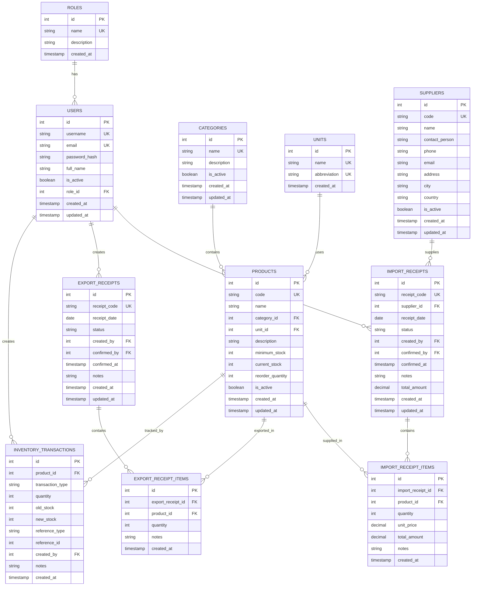

# THIẾT KẾ ERD (Entity-Relationship Diagram)
## Hệ Thống Quản Lý Kho Có Tích Hợp AI

---

## 1. DANH SÁCH ENTITIES VÀ THUỘC TÍNH

### 1.1 Entity: USERS (Người Dùng)

| Cột | Kiểu | Ràng Buộc | Mô Tả |
|-----|------|----------|-------|
| id | INTEGER | PK | ID người dùng (auto increment) |
| username | VARCHAR(50) | UNIQUE, NOT NULL | Tên đăng nhập |
| email | VARCHAR(100) | UNIQUE, NOT NULL | Email |
| password_hash | VARCHAR(255) | NOT NULL | Hash mật khẩu |
| full_name | VARCHAR(100) | NOT NULL | Họ và tên |
| is_active | BOOLEAN | NOT NULL, DEFAULT=True | Kích hoạt hay không |
| role_id | INTEGER | FK (roles.id), NOT NULL | Vai trò |
| created_at | TIMESTAMP | NOT NULL, DEFAULT=now() | Ngày tạo |
| updated_at | TIMESTAMP | NOT NULL, DEFAULT=now() | Ngày cập nhật |

**Indexes:**
- `idx_users_username`: UNIQUE trên username
- `idx_users_email`: UNIQUE trên email
- `idx_users_role_id`: Để join với roles

---

### 1.2 Entity: ROLES (Vai Trò)

| Cột | Kiểu | Ràng Buộc | Mô Tả |
|-----|------|----------|-------|
| id | INTEGER | PK | ID vai trò |
| name | VARCHAR(50) | UNIQUE, NOT NULL | Tên vai trò (ADMIN, STOREKEEPER, ACCOUNTANT) |
| description | TEXT | | Mô tả vai trò |
| created_at | TIMESTAMP | NOT NULL, DEFAULT=now() | Ngày tạo |

**Dữ liệu mẫu:**
```
id=1, name='ADMIN'
id=2, name='STOREKEEPER'
id=3, name='ACCOUNTANT'
```

---

### 1.3 Entity: CATEGORIES (Nhóm Hàng)

| Cột | Kiểu | Ràng Buộc | Mô Tả |
|-----|------|----------|-------|
| id | INTEGER | PK | ID nhóm hàng |
| name | VARCHAR(100) | UNIQUE, NOT NULL | Tên nhóm (VD: Điện tử, Văn phòng phẩm) |
| description | TEXT | | Mô tả |
| is_active | BOOLEAN | NOT NULL, DEFAULT=True | Kích hoạt hay không |
| created_at | TIMESTAMP | NOT NULL, DEFAULT=now() | Ngày tạo |
| updated_at | TIMESTAMP | NOT NULL, DEFAULT=now() | Ngày cập nhật |

**Dữ liệu mẫu:**
```
id=1, name='Điện tử'
id=2, name='Văn phòng phẩm'
id=3, name='Phụ kiện máy tính'
```

---

### 1.4 Entity: UNITS (Đơn Vị Tính)

| Cột | Kiểu | Ràng Buộc | Mô Tả |
|-----|------|----------|-------|
| id | INTEGER | PK | ID đơn vị |
| name | VARCHAR(50) | UNIQUE, NOT NULL | Tên đơn vị (cái, bộ, hộp, bao, thùng) |
| abbreviation | VARCHAR(10) | UNIQUE, NOT NULL | Viết tắt (cái, bộ, hộp, ...) |
| created_at | TIMESTAMP | NOT NULL, DEFAULT=now() | Ngày tạo |

**Dữ liệu mẫu:**
```
id=1, name='Cái', abbreviation='cái'
id=2, name='Bộ', abbreviation='bộ'
id=3, name='Hộp', abbreviation='hộp'
id=4, name='Thùng', abbreviation='thùng'
id=5, name='Bao', abbreviation='bao'
```

---

### 1.5 Entity: SUPPLIERS (Nhà Cung Cấp)

| Cột | Kiểu | Ràng Buộc | Mô Tả |
|-----|------|----------|-------|
| id | INTEGER | PK | ID NCC |
| code | VARCHAR(50) | UNIQUE, NOT NULL | Mã NCC (VD: NCC-001) |
| name | VARCHAR(100) | NOT NULL | Tên NCC |
| contact_person | VARCHAR(100) | | Người liên hệ |
| phone | VARCHAR(20) | | Số điện thoại |
| email | VARCHAR(100) | | Email |
| address | TEXT | | Địa chỉ |
| city | VARCHAR(50) | | Thành phố |
| country | VARCHAR(50) | | Quốc gia |
| is_active | BOOLEAN | NOT NULL, DEFAULT=True | Kích hoạt hay không |
| created_at | TIMESTAMP | NOT NULL, DEFAULT=now() | Ngày tạo |
| updated_at | TIMESTAMP | NOT NULL, DEFAULT=now() | Ngày cập nhật |

**Indexes:**
- `idx_suppliers_code`: UNIQUE trên code

**Dữ liệu mẫu:**
```
id=1, code='NCC-001', name='Công ty A', phone='0123456789'
id=2, code='NCC-002', name='Công ty B', phone='0987654321'
```

---

### 1.6 Entity: PRODUCTS (Hàng Hóa)

| Cột | Kiểu | Ràng Buộc | Mô Tả |
|-----|------|----------|-------|
| id | INTEGER | PK | ID hàng |
| code | VARCHAR(50) | UNIQUE, NOT NULL | Mã hàng (VD: HH001) |
| name | VARCHAR(200) | NOT NULL | Tên hàng |
| category_id | INTEGER | FK (categories.id), NOT NULL | Nhóm hàng |
| unit_id | INTEGER | FK (units.id), NOT NULL | Đơn vị tính |
| description | TEXT | | Mô tả |
| minimum_stock | INTEGER | NOT NULL, DEFAULT=0 | Tồn tối thiểu |
| current_stock | INTEGER | NOT NULL, DEFAULT=0 | Tồn hiện tại |
| reorder_quantity | INTEGER | | Số lượng đề xuất khi nhập |
| is_active | BOOLEAN | NOT NULL, DEFAULT=True | Kích hoạt hay không |
| created_at | TIMESTAMP | NOT NULL, DEFAULT=now() | Ngày tạo |
| updated_at | TIMESTAMP | NOT NULL, DEFAULT=now() | Ngày cập nhật |

**Indexes:**
- `idx_products_code`: UNIQUE trên code
- `idx_products_category_id`: Để join với categories
- `idx_products_current_stock`: Để tìm hàng dưới tồn tối thiểu

**Ràng Buộc:**
- `current_stock >= 0`: Tồn kho không được âm
- `minimum_stock >= 0`: Tồn tối thiểu không được âm

**Dữ liệu mẫu:**
```
id=1, code='HH001', name='Bàn phím cơ', category_id=3, unit_id=1, 
      minimum_stock=10, current_stock=5

id=2, code='HH002', name='Chuột không dây', category_id=3, unit_id=1, 
      minimum_stock=20, current_stock=35

id=3, code='HH003', name='Tai nghe', category_id=3, unit_id=1, 
      minimum_stock=15, current_stock=8
```

---

### 1.7 Entity: IMPORT_RECEIPTS (Phiếu Nhập Kho)

| Cột | Kiểu | Ràng Buộc | Mô Tả |
|-----|------|----------|-------|
| id | INTEGER | PK | ID phiếu |
| receipt_code | VARCHAR(50) | UNIQUE, NOT NULL | Mã phiếu (VD: IMP-20260816-001) |
| supplier_id | INTEGER | FK (suppliers.id), NOT NULL | Nhà cung cấp |
| receipt_date | DATE | NOT NULL | Ngày nhập |
| status | VARCHAR(20) | NOT NULL, DEFAULT='DRAFT' | Trạng thái (DRAFT, CONFIRMED, CANCELLED) |
| created_by | INTEGER | FK (users.id), NOT NULL | Người tạo |
| confirmed_by | INTEGER | FK (users.id), NULLABLE | Người xác nhận |
| confirmed_at | TIMESTAMP | NULLABLE | Thời gian xác nhận |
| notes | TEXT | | Ghi chú |
| total_amount | DECIMAL(15,2) | | Tổng tiền |
| created_at | TIMESTAMP | NOT NULL, DEFAULT=now() | Ngày tạo |
| updated_at | TIMESTAMP | NOT NULL, DEFAULT=now() | Ngày cập nhật |

**Indexes:**
- `idx_import_receipts_code`: UNIQUE trên receipt_code
- `idx_import_receipts_status`: Để lọc theo trạng thái
- `idx_import_receipts_supplier_id`: Để join với suppliers
- `idx_import_receipts_receipt_date`: Để lọc theo ngày

**Ràng Buộc:**
- `status IN ('DRAFT', 'CONFIRMED', 'CANCELLED')`

---

### 1.8 Entity: IMPORT_RECEIPT_ITEMS (Chi Tiết Phiếu Nhập)

| Cột | Kiểu | Ràng Buộc | Mô Tả |
|-----|------|----------|-------|
| id | INTEGER | PK | ID chi tiết |
| import_receipt_id | INTEGER | FK (import_receipts.id), NOT NULL | Phiếu nhập |
| product_id | INTEGER | FK (products.id), NOT NULL | Hàng hóa |
| quantity | INTEGER | NOT NULL | Số lượng nhập |
| unit_price | DECIMAL(15,2) | NOT NULL | Đơn giá |
| total_amount | DECIMAL(15,2) | COMPUTED | Tổng tiền (quantity * unit_price) |
| notes | TEXT | | Ghi chú |
| created_at | TIMESTAMP | NOT NULL, DEFAULT=now() | Ngày tạo |

**Indexes:**
- `idx_import_receipt_items_receipt_id`: Để join với import_receipts
- `idx_import_receipt_items_product_id`: Để join với products

**Ràng Buộc:**
- `quantity > 0`: Số lượng nhập phải > 0
- `unit_price >= 0`: Đơn giá không được âm
- `UNIQUE (import_receipt_id, product_id)`: Mỗi sản phẩm chỉ xuất hiện 1 lần trong phiếu

---

### 1.9 Entity: EXPORT_RECEIPTS (Phiếu Xuất Kho)

| Cột | Kiểu | Ràng Buộc | Mô Tả |
|-----|------|----------|-------|
| id | INTEGER | PK | ID phiếu |
| receipt_code | VARCHAR(50) | UNIQUE, NOT NULL | Mã phiếu (VD: EXP-20260816-001) |
| receipt_date | DATE | NOT NULL | Ngày xuất |
| status | VARCHAR(20) | NOT NULL, DEFAULT='DRAFT' | Trạng thái (DRAFT, CONFIRMED, CANCELLED) |
| created_by | INTEGER | FK (users.id), NOT NULL | Người tạo |
| confirmed_by | INTEGER | FK (users.id), NULLABLE | Người xác nhận |
| confirmed_at | TIMESTAMP | NULLABLE | Thời gian xác nhận |
| notes | TEXT | | Ghi chú |
| created_at | TIMESTAMP | NOT NULL, DEFAULT=now() | Ngày tạo |
| updated_at | TIMESTAMP | NOT NULL, DEFAULT=now() | Ngày cập nhật |

**Indexes:**
- `idx_export_receipts_code`: UNIQUE trên receipt_code
- `idx_export_receipts_status`: Để lọc theo trạng thái
- `idx_export_receipts_receipt_date`: Để lọc theo ngày

**Ràng Buộc:**
- `status IN ('DRAFT', 'CONFIRMED', 'CANCELLED')`

---

### 1.10 Entity: EXPORT_RECEIPT_ITEMS (Chi Tiết Phiếu Xuất)

| Cột | Kiểu | Ràng Buộc | Mô Tả |
|-----|------|----------|-------|
| id | INTEGER | PK | ID chi tiết |
| export_receipt_id | INTEGER | FK (export_receipts.id), NOT NULL | Phiếu xuất |
| product_id | INTEGER | FK (products.id), NOT NULL | Hàng hóa |
| quantity | INTEGER | NOT NULL | Số lượng xuất |
| notes | TEXT | | Ghi chú |
| created_at | TIMESTAMP | NOT NULL, DEFAULT=now() | Ngày tạo |

**Indexes:**
- `idx_export_receipt_items_receipt_id`: Để join với export_receipts
- `idx_export_receipt_items_product_id`: Để join với products

**Ràng Buộc:**
- `quantity > 0`: Số lượng xuất phải > 0
- `UNIQUE (export_receipt_id, product_id)`: Mỗi sản phẩm chỉ xuất hiện 1 lần trong phiếu

---

### 1.11 Entity: INVENTORY_TRANSACTIONS (Lịch Sử Giao Dịch)

| Cột | Kiểu | Ràng Buộc | Mô Tả |
|-----|------|----------|-------|
| id | INTEGER | PK | ID giao dịch |
| product_id | INTEGER | FK (products.id), NOT NULL | Hàng hóa |
| transaction_type | VARCHAR(20) | NOT NULL | Loại (IMPORT, EXPORT) |
| quantity | INTEGER | NOT NULL | Số lượng thay đổi (luôn dương) |
| old_stock | INTEGER | NOT NULL | Tồn cũ |
| new_stock | INTEGER | NOT NULL | Tồn mới |
| reference_type | VARCHAR(20) | | Loại tham chiếu (IMPORT_RECEIPT, EXPORT_RECEIPT) |
| reference_id | INTEGER | | ID tham chiếu |
| created_by | INTEGER | FK (users.id), NOT NULL | Người tạo giao dịch |
| notes | TEXT | | Ghi chú |
| created_at | TIMESTAMP | NOT NULL, DEFAULT=now() | Ngày tạo |

**Indexes:**
- `idx_inventory_transactions_product_id`: Để query theo sản phẩm
- `idx_inventory_transactions_created_at`: Để lọc theo ngày
- `idx_inventory_transactions_type`: Để lọc theo loại giao dịch

**Ràng Buộc:**
- `transaction_type IN ('IMPORT', 'EXPORT')`
- `quantity > 0`
- `new_stock >= 0`: Tồn cuối không được âm

**Dữ liệu mẫu:**
```
id=1, product_id=1, transaction_type='IMPORT', quantity=50, 
      old_stock=0, new_stock=50, reference_type='IMPORT_RECEIPT', reference_id=1

id=2, product_id=1, transaction_type='EXPORT', quantity=20, 
      old_stock=50, new_stock=30, reference_type='EXPORT_RECEIPT', reference_id=1
```

---

## 2. MỐI QUAN HỆ GIỮA CÁC ENTITIES

```
ROLES (1)
  ↓
  ↓ 1:N
  ↓
USERS (N)
  ├─ 1:N → IMPORT_RECEIPTS (created_by)
  ├─ 1:N → EXPORT_RECEIPTS (created_by)
  └─ 1:N → INVENTORY_TRANSACTIONS (created_by)

CATEGORIES (1)
  ↓
  ↓ 1:N
  ↓
PRODUCTS (N)
  ├─ 1:N → IMPORT_RECEIPT_ITEMS
  ├─ 1:N → EXPORT_RECEIPT_ITEMS
  └─ 1:N → INVENTORY_TRANSACTIONS

UNITS (1)
  ↓
  ↓ 1:N
  ↓
PRODUCTS (N)

SUPPLIERS (1)
  ↓
  ↓ 1:N
  ↓
IMPORT_RECEIPTS (N)

IMPORT_RECEIPTS (1)
  ↓
  ↓ 1:N
  ↓
IMPORT_RECEIPT_ITEMS (N)

EXPORT_RECEIPTS (1)
  ↓
  ↓ 1:N
  ↓
EXPORT_RECEIPT_ITEMS (N)
```

---

## 3. MERMAID ERD DIAGRAM



---

## 4. MERMAID TEXT DIAGRAM

```
┌──────────────────────────────────────────────────────────────────────┐
│                           WAREHOUSE DATABASE                          │
└──────────────────────────────────────────────────────────────────────┘

┌─────────────────────────┐         ┌──────────────────────────┐
│        ROLES            │         │        USERS             │
├─────────────────────────┤         ├──────────────────────────┤
│ id (PK)                 │◄────────│ id (PK)                  │
│ name (UK)               │ 1:N     │ username (UK)            │
│ description             │         │ email (UK)               │
│ created_at              │         │ password_hash            │
└─────────────────────────┘         │ full_name                │
                                    │ is_active                │
                                    │ role_id (FK) → ROLES.id  │
                                    │ created_at               │
                                    │ updated_at               │
                                    └──────────────────────────┘
                                              ▲
                           ┌──────────────────┼──────────────────┐
                           │                  │                  │
                    created_by          created_by          created_by
                           │                  │                  │
          ┌─────────────────▼──┐   ┌─────────────────▼──┐   ┌─────────────────▼──┐
          │ IMPORT_RECEIPTS    │   │ EXPORT_RECEIPTS    │   │INVENTORY_TRANSACT..│
          ├────────────────────┤   ├────────────────────┤   ├────────────────────┤
          │ id (PK)            │   │ id (PK)            │   │ id (PK)            │
          │ receipt_code (UK)  │   │ receipt_code (UK)  │   │ product_id (FK)    │
          │ supplier_id (FK)───┼──►│                    │   │ transaction_type   │
          │ receipt_date       │   │ receipt_date       │   │ quantity           │
          │ status             │   │ status             │   │ old_stock          │
          │ created_by (FK)    │   │ created_by (FK)    │   │ new_stock          │
          │ confirmed_by (FK)  │   │ confirmed_by (FK)  │   │ reference_type     │
          │ confirmed_at       │   │ confirmed_at       │   │ reference_id       │
          │ notes              │   │ notes              │   │ created_by (FK)    │
          │ total_amount       │   │ created_at         │   │ notes              │
          │ created_at         │   │ updated_at         │   │ created_at         │
          │ updated_at         │   └────────────────────┘   └────────────────────┘
          └──────────┬─────────┘           │
                     │ 1:N                 │ 1:N
                     │                     │
          ┌──────────▼──────────┐   ┌──────▼───────────────┐
          │IMPORT_RECEIPT_ITEMS │   │EXPORT_RECEIPT_ITEMS │
          ├─────────────────────┤   ├─────────────────────┤
          │ id (PK)             │   │ id (PK)             │
          │ import_receipt_id───┼──►│ export_receipt_id───┼──►
          │ product_id (FK)─────┼──┐│ product_id (FK)─────┼──┐
          │ quantity            │  ││ quantity            │  │
          │ unit_price          │  ││ notes               │  │
          │ total_amount        │  ││ created_at          │  │
          │ notes               │  │└─────────────────────┘  │
          │ created_at          │  │                         │
          └─────────────────────┘  │                         │
                                    │ 1:N                    │ 1:N
                                    │                        │
                    ┌───────────────┴────────────────────┐
                    │                                    │
                    │                                    │
          ┌─────────▼──────────────┐         ┌──────────▼────────┐
          │       PRODUCTS          │         │   CATEGORIES       │
          ├────────────────────────┤         ├───────────────────┤
          │ id (PK)                 │         │ id (PK)            │
          │ code (UK)               │         │ name (UK)          │
          │ name                    │         │ description        │
          │ category_id (FK)────────┼────────►│ is_active          │
          │ unit_id (FK)            │         │ created_at         │
          │ description             │         │ updated_at         │
          │ minimum_stock           │         └───────────────────┘
          │ current_stock           │
          │ reorder_quantity        │         ┌───────────────────┐
          │ is_active               │         │      UNITS        │
          │ created_at              │         ├───────────────────┤
          │ updated_at              │         │ id (PK)            │
          └─────────────────────────┘         │ name (UK)          │
                    ▲                         │ abbreviation (UK)  │
                    │ 1:N                     │ created_at         │
                    │                         └───────────────────┘
                    │
                    └─ unit_id (FK)

                    ┌─────────────────┐
                    │   SUPPLIERS      │
                    ├─────────────────┤
                    │ id (PK)         │
                    │ code (UK)       │
                    │ name            │
                    │ contact_person  │
                    │ phone           │
                    │ email           │
                    │ address         │
                    │ city            │
                    │ country         │
                    │ is_active       │
                    │ created_at      │
                    │ updated_at      │
                    └─────────────────┘
                             ▲
                             │ 1:N
                             │
                    supplier_id (FK)
                    IMPORT_RECEIPTS
```

---

## 5. KHÓ CHÍNH VÀ RÀNG BUỘC

### Khóa Chính (Primary Keys)
- ROLES.id
- USERS.id
- CATEGORIES.id
- UNITS.id
- SUPPLIERS.id
- PRODUCTS.id
- IMPORT_RECEIPTS.id
- IMPORT_RECEIPT_ITEMS.id
- EXPORT_RECEIPTS.id
- EXPORT_RECEIPT_ITEMS.id
- INVENTORY_TRANSACTIONS.id

### Khóa Ngoại (Foreign Keys)
1. USERS.role_id → ROLES.id (NOT NULL)
2. PRODUCTS.category_id → CATEGORIES.id (NOT NULL)
3. PRODUCTS.unit_id → UNITS.id (NOT NULL)
4. IMPORT_RECEIPTS.supplier_id → SUPPLIERS.id (NOT NULL)
5. IMPORT_RECEIPTS.created_by → USERS.id (NOT NULL)
6. IMPORT_RECEIPTS.confirmed_by → USERS.id (NULLABLE)
7. IMPORT_RECEIPT_ITEMS.import_receipt_id → IMPORT_RECEIPTS.id (NOT NULL)
8. IMPORT_RECEIPT_ITEMS.product_id → PRODUCTS.id (NOT NULL)
9. EXPORT_RECEIPTS.created_by → USERS.id (NOT NULL)
10. EXPORT_RECEIPTS.confirmed_by → USERS.id (NULLABLE)
11. EXPORT_RECEIPT_ITEMS.export_receipt_id → EXPORT_RECEIPTS.id (NOT NULL)
12. EXPORT_RECEIPT_ITEMS.product_id → PRODUCTS.id (NOT NULL)
13. INVENTORY_TRANSACTIONS.product_id → PRODUCTS.id (NOT NULL)
14. INVENTORY_TRANSACTIONS.created_by → USERS.id (NOT NULL)

### Ràng Buộc Unique (Unique Constraints)
- USERS.username
- USERS.email
- CATEGORIES.name
- UNITS.name
- UNITS.abbreviation
- SUPPLIERS.code
- PRODUCTS.code
- IMPORT_RECEIPTS.receipt_code
- EXPORT_RECEIPTS.receipt_code
- IMPORT_RECEIPT_ITEMS: (import_receipt_id, product_id)
- EXPORT_RECEIPT_ITEMS: (export_receipt_id, product_id)

### Ràng Buộc Check (Check Constraints)
- PRODUCTS.current_stock >= 0
- PRODUCTS.minimum_stock >= 0
- IMPORT_RECEIPT_ITEMS.quantity > 0
- IMPORT_RECEIPT_ITEMS.unit_price >= 0
- EXPORT_RECEIPT_ITEMS.quantity > 0
- INVENTORY_TRANSACTIONS.quantity > 0
- INVENTORY_TRANSACTIONS.new_stock >= 0

---

## 6. INDEXES ĐỀ XUẤT

**Để tăng hiệu năng query:**

```sql
-- USERS
CREATE UNIQUE INDEX idx_users_username ON users(username);
CREATE UNIQUE INDEX idx_users_email ON users(email);
CREATE INDEX idx_users_role_id ON users(role_id);

-- PRODUCTS
CREATE UNIQUE INDEX idx_products_code ON products(code);
CREATE INDEX idx_products_category_id ON products(category_id);
CREATE INDEX idx_products_current_stock ON products(current_stock);
CREATE INDEX idx_products_is_active ON products(is_active);

-- IMPORT_RECEIPTS
CREATE UNIQUE INDEX idx_import_receipts_code ON import_receipts(receipt_code);
CREATE INDEX idx_import_receipts_status ON import_receipts(status);
CREATE INDEX idx_import_receipts_supplier_id ON import_receipts(supplier_id);
CREATE INDEX idx_import_receipts_receipt_date ON import_receipts(receipt_date);

-- IMPORT_RECEIPT_ITEMS
CREATE INDEX idx_import_receipt_items_receipt_id ON import_receipt_items(import_receipt_id);
CREATE INDEX idx_import_receipt_items_product_id ON import_receipt_items(product_id);

-- EXPORT_RECEIPTS
CREATE UNIQUE INDEX idx_export_receipts_code ON export_receipts(receipt_code);
CREATE INDEX idx_export_receipts_status ON export_receipts(status);
CREATE INDEX idx_export_receipts_receipt_date ON export_receipts(receipt_date);

-- EXPORT_RECEIPT_ITEMS
CREATE INDEX idx_export_receipt_items_receipt_id ON export_receipt_items(export_receipt_id);
CREATE INDEX idx_export_receipt_items_product_id ON export_receipt_items(product_id);

-- INVENTORY_TRANSACTIONS
CREATE INDEX idx_inventory_transactions_product_id ON inventory_transactions(product_id);
CREATE INDEX idx_inventory_transactions_created_at ON inventory_transactions(created_at);
CREATE INDEX idx_inventory_transactions_type ON inventory_transactions(transaction_type);
```

---

## 7. KIỂM THỬ TÍNH TOÀN VẸN DỮ LIỆU

### Ràng Buộc Đầu Vào
- Mã hàng (PRODUCTS.code) phải unique và not null
- Username (USERS.username) phải unique và not null
- Mã phiếu (receipt_code) phải unique
- Số lượng nhập/xuất phải > 0
- Tồn kho không được âm

### Kiểm Tra Tính Toàn Vẹn
```sql
-- Kiểm tra tồn kho âm
SELECT * FROM products WHERE current_stock < 0;

-- Kiểm tra tổng tồn = tổng nhập - tổng xuất
SELECT 
    p.id,
    p.code,
    p.current_stock,
    COALESCE(SUM(CASE WHEN it.transaction_type='IMPORT' THEN it.quantity ELSE 0 END), 0) as total_import,
    COALESCE(SUM(CASE WHEN it.transaction_type='EXPORT' THEN it.quantity ELSE 0 END), 0) as total_export,
    COALESCE(SUM(CASE WHEN it.transaction_type='IMPORT' THEN it.quantity ELSE 0 END), 0) - 
    COALESCE(SUM(CASE WHEN it.transaction_type='EXPORT' THEN it.quantity ELSE 0 END), 0) as calculated_stock
FROM products p
LEFT JOIN inventory_transactions it ON p.id = it.product_id
GROUP BY p.id
HAVING p.current_stock != calculated_stock;

-- Kiểm tra orphaned records (chi tiết phiếu không có phiếu)
SELECT * FROM import_receipt_items iri 
WHERE NOT EXISTS (SELECT 1 FROM import_receipts ir WHERE ir.id = iri.import_receipt_id);
```

---

## 8. KIẾN NGHỊ CHO BƯỚC 3

**Bước 3: Thiết kế Database SQLAlchemy**

Sẽ định nghĩa:
- Các SQLAlchemy Model tương ứng với mỗi Entity
- Relationship giữa các Model
- Column definitions với proper types và constraints
- Validators trong Model
- Migration strategy (alembic)

---

**Ngày thiết kế: 2024-08-16**
**Phiên bản: 1.0**
